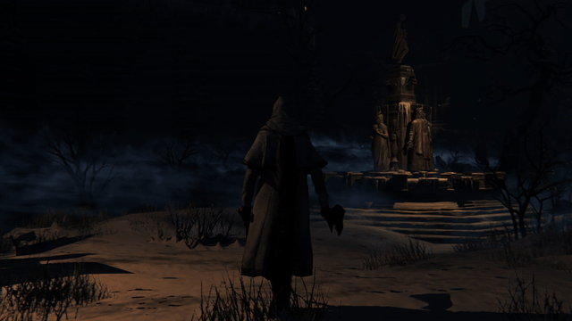
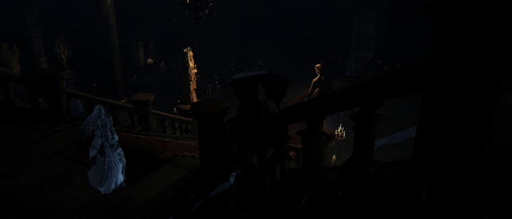
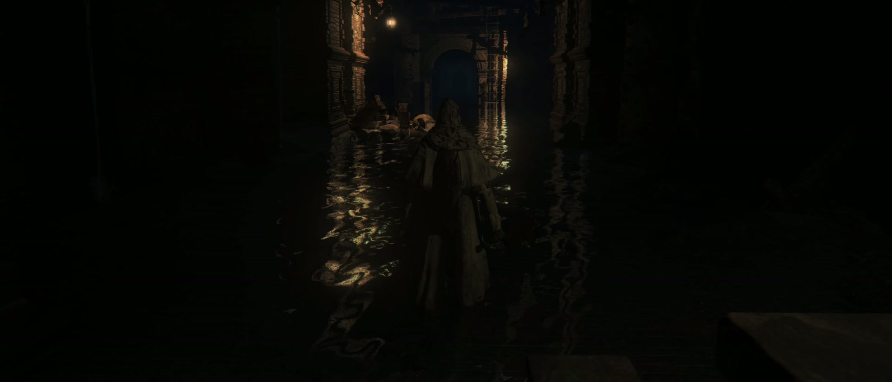
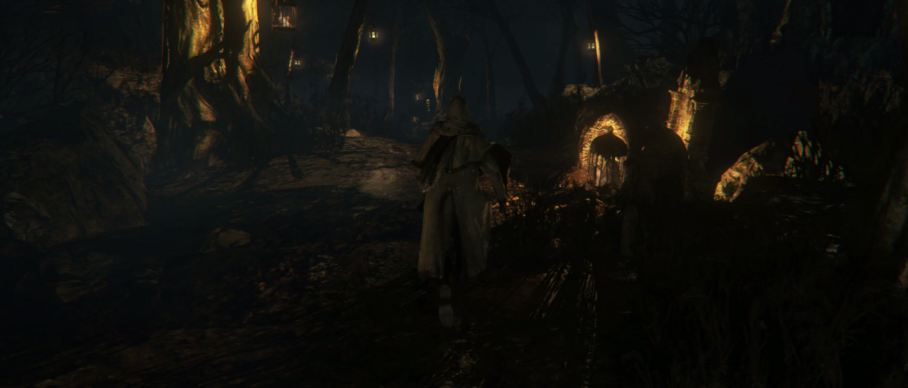

# Bloodborne PC Path Tracing installer

Adds real-time path tracing to [SuperMedo's Bloodborne PC port](https://github.com/Supermedo/bloodborne_pc):
moonlight and bounce light, traced shadows and reflections, water and puddle mirrors, traced glass.

> **Alpha.** This is an early build and work is ongoing: light sources are being remade, along
> with effects such as fire, fog and glows, water and the overall look. Expect bugs, places that
> look wrong, and big changes between versions.









## Download

**[Download the latest release](https://github.com/Joaovitor404silva/bloodborne-pc-path-tracing/releases/latest)**
(`Bloodborne-PC-Path-Tracing-pt2.2.zip`).

## Needs

- Bloodborne PC **1.9.8.4** (SuperMedo), installed and working:
  [windows-v1.9.8.4](https://github.com/Supermedo/bloodborne_pc/releases/tag/windows-v1.9.8.4)
- A ray tracing GPU: GeForce RTX or Radeon RX 6000 and newer.
- Your own copy of the game. No game files are included.

## What the mod is

Four files on top of SuperMedo's port; everything else stays his:

| File | What it is |
|---|---|
| `bin/bb-probe.exe` | The port's game engine, built from his source with the path tracer added |
| `bin/bbport_dlss.dll` | The DLSS bridge, with Ray Reconstruction added |
| `bin/nvngx_dlssd.dll` | NVIDIA's DLSS Ray Reconstruction (new file) |
| `bin/libc++.dll` | MSYS2's newer LLVM C++ runtime: the engine needs a function his copy lacks; every other program and DLL of the port is checked to work with it |

Path tracing is switched on by a line of variables in his launcher: Advanced > Diagnostics >
Extra variables. The installer writes it for you.

## Install

1. Close the game and the launcher.
2. Unzip the release anywhere (inside the Bloodborne PC folder is easiest).
3. Run `Install Path Tracing.bat`. It finds the game folder, or asks for it.
4. Start `Bloodborne.exe` as usual.

In game, press **F9** to turn path tracing off and on and compare with the stock lighting.
Give it about 3 seconds after each press while the exposure adjusts.

The installer checks the folder is 1.9.8.4, backs up the 3 files it replaces to `rt-backup`,
copies the 4 files and checks each by SHA-256. It adds the path tracing variables to the
launcher's Extra variables and keeps any you already had.

In a protected folder such as Program Files, Windows asks for administrator rights. If a copy
fails (a file in use by the game or an antivirus), the installer puts every file back, leaves the
folder as it was, and says what failed.

**Upscaler:** path tracing is not tested under FSR 4.1, which is the launcher's
automatic pick. In that case the installer sets DLSS on NVIDIA cards and FSR 3.1 on others.
Keep DLSS or FSR 3.1.

**Launcher updates:** an update of Bloodborne PC replaces `bb-probe.exe`, and path tracing is
gone. Install the mod version made for the new Bloodborne PC; do not run the old version's
uninstaller after updating.

**Seamless co-op:** the launcher's Seamless co-op mode runs its own engine
(`bb-probe-seamless.exe`) without path tracing. Path tracing works in normal play.

## Fixed in pt2.2: path tracing staying off

In the earlier versions path tracing could stay off for the whole session, so the lighting
looked like stock. The loading screen filled its memory and none of it was ever freed. pt2.2
frees it at the end of each frame. In our test from a fresh install (DLSS), the previous
release stayed off and pt2.2 traced every in-game frame.

FSR 4.1 and frame generation are not tested again yet, so the installer still picks DLSS or
FSR 3.1 instead of FSR 4.1.

## Uninstall

Run `Uninstall Path Tracing.bat`. It restores the 3 backed-up files, removes NVIDIA's Ray
Reconstruction DLL, takes the variables out of Extra variables and puts your old upscaler back.

## Source

`source/` holds only our work; SuperMedo's code is in his repository.

- Files we wrote are there as they are: the path tracer
  (`source/gpu/shadps4/video_core/renderer_vulkan/rt/`), its shaders
  (`source/gpu/shadps4/video_core/host_shaders/rt_*.comp`), tests and tools.
- Our changes to his files are one patch: `source/supermedo-1.9.8.4.patch`.

Rebuild the exact pt2 tree:

```
git clone --recursive --branch windows-v1.9.8.4 https://github.com/Supermedo/bloodborne_pc
git clone https://github.com/Joaovitor404silva/bloodborne-pc-path-tracing
cp -r bloodborne-pc-path-tracing/source/. bloodborne_pc/
cd bloodborne_pc && git apply supermedo-1.9.8.4.patch
```

Then build on Windows (MSYS2 CLANG64) as in his `packaging/windows/README.md`: `bash build.sh`
gives `out/bb-probe.exe`; `packaging/windows/build_dlss.sh` gives `out/bbport_dlss.dll` (needs
the NVIDIA DLSS SDK, see `docs/PATH_TRACING.md`, "Fetching the DLL and SDK").

Tweaks without rebuilding: the `BB_RT_*` variables in
`source/gpu/shadps4/video_core/renderer_vulkan/rt/vk_ray_tracing.cpp` go in Extra variables,
for example `BB_RT_GI_STRENGTH=1.3 BB_RT_REFLECT_STRENGTH=0.8`. The design notes and every A/B
behind the defaults: `source/docs/PATH_TRACING.md`.

## Build the release

When SuperMedo releases a new Bloodborne PC, `tools/port_update.py` moves the mod to it, one step
at a time (`tools/port.json` holds the last released versions and the paths):

```
python tools/port_update.py check                    # is there a newer Bloodborne PC?
python tools/port_update.py merge                    # his new tag + our last release, in a new worktree
python tools/port_update.py build                    # build.sh, strip, DLSS bridge if it changed, DLL check
python tools/port_update.py package --rt pt2.3       # installer folder, GitHub + Nexus zips, source/, notes
python tools/port_update.py test --rt pt2.3          # tools/test_installer.ps1 on the stock folder
python tools/port_update.py release --rt pt2.3 --yes # tag, commit, push, GitHub release
```

Between `test` and `release`, play it: install the `dist` folder into a copy of the stock folder,
start the game, press F9. Merge conflicts stop at `merge`: resolve, `git commit`, go on with `build`.

## License

The path tracer and this installer are GPL-2.0, like the port. NVIDIA's DLSS DLL ships under
the NVIDIA DLSS SDK licence (it is in the port's `licenses` folder).

Path tracing by Joao vitor alves on top of SuperMedo's Bloodborne PC.
