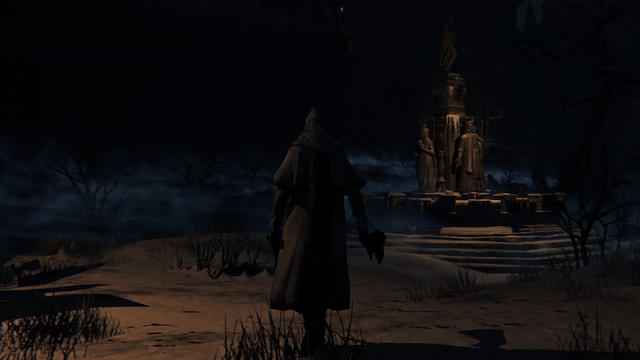
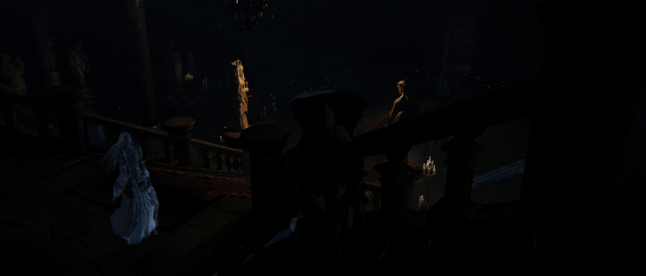
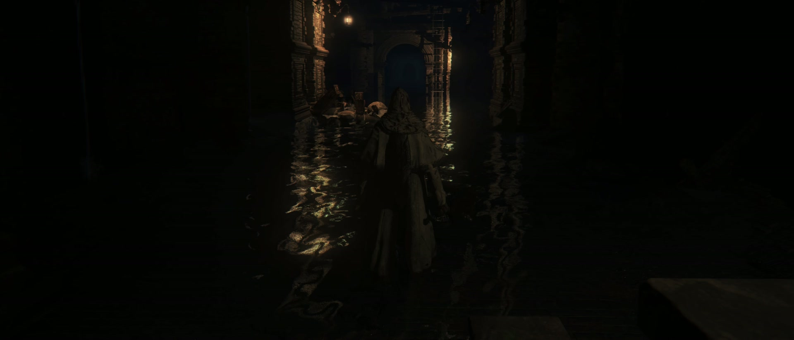
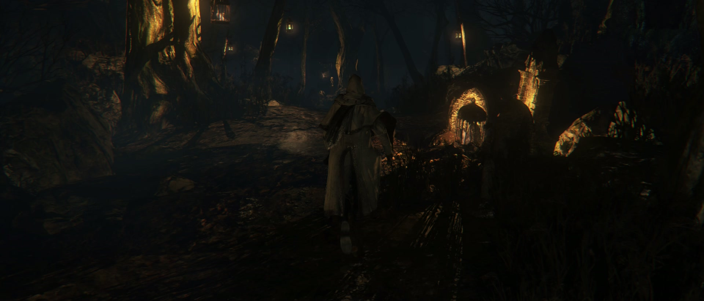
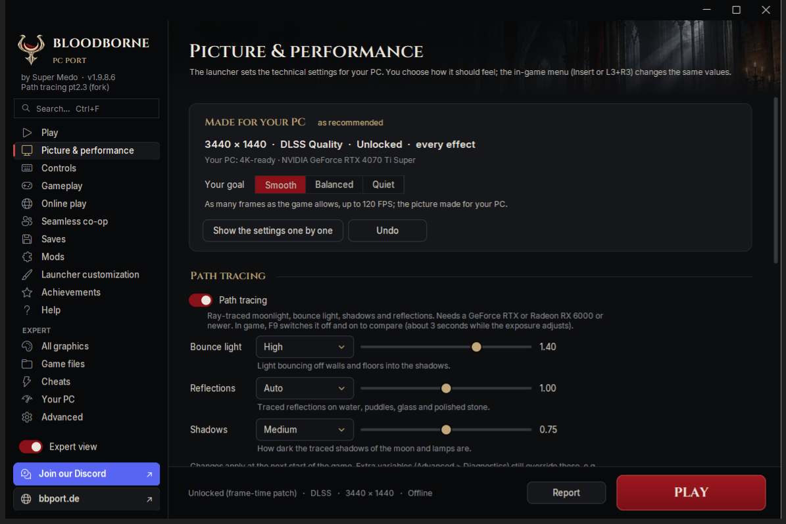

# Bloodborne PC Path Tracing

Adds real-time path tracing to [SuperMedo's Bloodborne PC port](https://github.com/Supermedo/bloodborne_pc):
moonlight and bounce light, traced shadows and reflections, water and puddle mirrors, traced glass.

> **Alpha.** This is an early build and work is ongoing: light sources are being remade, along
> with effects such as fire, fog and glows, water and the overall look. Expect bugs, places that
> look wrong, and big changes between versions.









## Download

**[Download the latest release](https://github.com/Joaovitor404silva/bloodborne-pc-path-tracing/releases/latest)**
(`Bloodborne-Windows.zip`).

It is SuperMedo's whole Bloodborne PC 1.9.8.6 with path tracing built in: one unzip, nothing to
install on top. All credit for the port (launcher, DLSS/FSR, online, everything but path tracing)
goes to [SuperMedo](https://github.com/Supermedo/bloodborne_pc). Report path tracing problems
here, not to him.

## Needs

- A ray tracing GPU: GeForce RTX or Radeon RX 6000 and newer.
- Your own copy of the game. No game files are included.

## Install

1. Unzip `Bloodborne-Windows.zip` into a new folder (do not unzip over another Bloodborne PC).
2. Start `Bloodborne.exe` and set the game up as in SuperMedo's port.

Path tracing is on by default. In game, press **F9** to turn it off and on and compare with the
stock lighting. Give it about 3 seconds after each press while the exposure adjusts.

## What is different from SuperMedo's 1.9.8.6

| File | What it is |
|---|---|
| `bin/bb-probe.exe` | The port's game engine, built from his source with the path tracer added |
| `bin/bbport_dlss.dll` | The DLSS bridge, with Ray Reconstruction added |
| `bin/nvngx_dlssd.dll` | NVIDIA's DLSS Ray Reconstruction (new file) |
| `bin/libc++.dll` | MSYS2's newer LLVM C++ runtime: the engine needs a function his copy lacks |
| `Bloodborne.exe` | His launcher with a Path tracing section; its updates come from this repository |

**Launcher, Picture & performance > Path tracing:** the switch, then bounce light, reflections
and shadows, each Auto (recommended), Low, Medium, High or Custom (a slider). More `BB_RT_*`
variables go in Advanced > Diagnostics > Extra variables.



**Upscalers:** DLSS, FSR 3.1 and FSR 4.1 all work with path tracing, with frame generation too.

**Updates:** the launcher only offers releases of this repository, so an update never removes
path tracing.

**Seamless co-op:** the launcher's Seamless co-op mode runs its own engine
(`bb-probe-seamless.exe`) without path tracing. Path tracing works in normal play.

**Older 4-file installer:** for an existing Bloodborne PC 1.9.8.6 folder it is still in the
[pt2.3 release](https://github.com/Joaovitor404silva/bloodborne-pc-path-tracing/releases/tag/pt2.3)
(`installer/`).

## Fixed in pt2.2: path tracing staying off

In the earlier versions path tracing could stay off for the whole session, so the lighting
looked like stock. The loading screen filled its memory and none of it was ever freed. pt2.2
frees it at the end of each frame. In our test from a fresh install (DLSS), the previous
release stayed off and pt2.2 traced every in-game frame.

## Source

**Full source, ready to build:** the branch
[path-tracing-1.9.8.6](https://github.com/Joaovitor404silva/bloodborne_pc/tree/path-tracing-1.9.8.6)
of our fork of SuperMedo's repository: all his files at `windows-v1.9.8.6` plus our work in one
commit. Its `README-PathTracing.md` builds the full download with his own scripts
(`build.sh`, `build_dlss.sh`, `package.sh`).

`source/` here holds only our work; SuperMedo's code is in his repository.

- Files we wrote are there as they are: the path tracer
  (`source/gpu/shadps4/video_core/renderer_vulkan/rt/`), its shaders
  (`source/gpu/shadps4/video_core/host_shaders/rt_*.comp`), tests and tools.
- Our changes to his engine files are one patch: `source/supermedo-1.9.8.6.patch`.
- Our changes to his launcher are one patch: `source/launcher-fork-1.9.8.6.patch`.

Rebuild the exact pt2 tree:

```
git clone --recursive --branch windows-v1.9.8.6 https://github.com/Supermedo/bloodborne_pc
git clone https://github.com/Joaovitor404silva/bloodborne-pc-path-tracing
cp -r bloodborne-pc-path-tracing/source/. bloodborne_pc/
cd bloodborne_pc && git apply supermedo-1.9.8.6.patch launcher-fork-1.9.8.6.patch
```

Then build on Windows (MSYS2 CLANG64) as in his `packaging/windows/README.md`: `bash build.sh`
gives `out/bb-probe.exe`; `packaging/windows/build_dlss.sh` gives `out/bbport_dlss.dll` (needs
the NVIDIA DLSS SDK, see `docs/PATH_TRACING.md`, "Fetching the DLL and SDK").

Tweaks without rebuilding: the `BB_RT_*` variables in
`source/gpu/shadps4/video_core/renderer_vulkan/rt/vk_ray_tracing.cpp` go in Extra variables,
for example `BB_RT_GI_STRENGTH=1.3 BB_RT_REFLECT_STRENGTH=0.8`. The design notes and every A/B
behind the defaults: `source/docs/PATH_TRACING.md`.

## Build the release

When SuperMedo releases a new Bloodborne PC, `tools/port_update.py` moves the mod to it, one step
at a time (`tools/port.json` holds the last released versions and the paths):

```
python tools/port_update.py check                    # is there a newer Bloodborne PC?
python tools/port_update.py merge                    # his new tag + our last release, in a new worktree
python tools/port_update.py build                    # build.sh, strip, DLSS bridge if it changed, DLL check
python tools/port_update.py package --rt pt2.3       # installer folder, GitHub + Nexus zips, source/, notes
python tools/port_update.py test --rt pt2.3          # tools/test_installer.ps1 on the stock folder
python tools/port_update.py release --rt pt2.3 --yes # tag, commit, push, GitHub release
```

The full download: freeze the launcher (PyInstaller, as in his `packaging/windows`), then
`python tools/make_full.py HIS_ZIP FORK_REPO PAYLOAD_BIN OUT_ZIP` puts his `Bloodborne-Windows.zip`,
our launcher and the 4 engine files together and rewrites `bbport-files.json`. Its release tag is
`windows-v<his version>-pt<N>` with the asset `Bloodborne-Windows.zip` (what the launcher updates from).

Between `test` and `release`, play it: install the `dist` folder into a copy of the stock folder,
start the game, press F9. Merge conflicts stop at `merge`: resolve, `git commit`, go on with `build`.

## License

The path tracer and this installer are GPL-2.0, like the port. NVIDIA's DLSS DLL ships under
the NVIDIA DLSS SDK licence (it is in the port's `licenses` folder).

Path tracing by Joao vitor alves on top of SuperMedo's Bloodborne PC.
